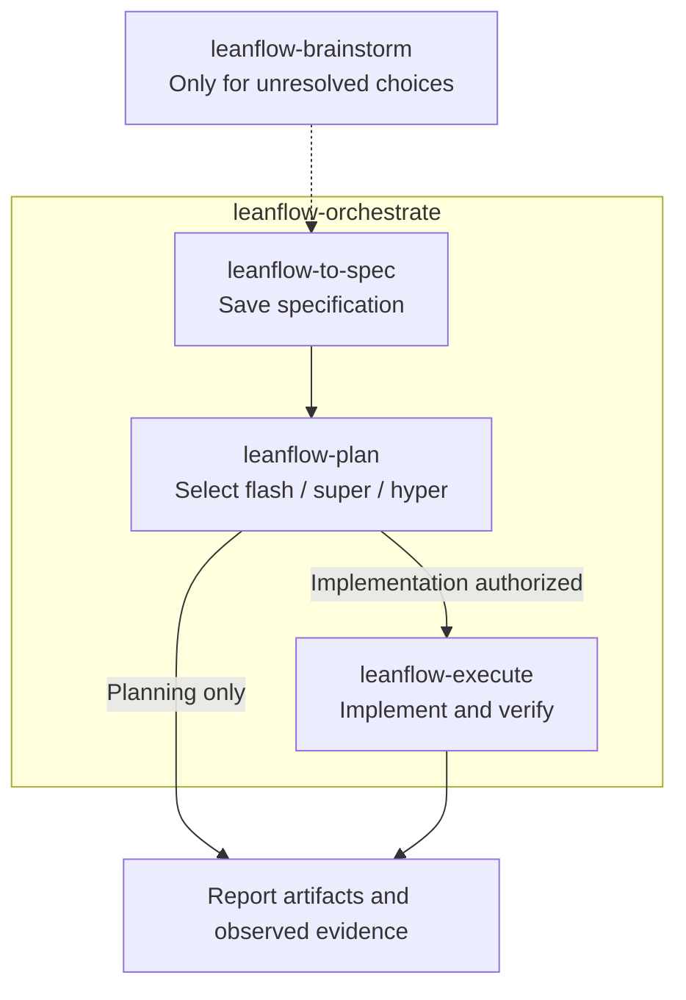

# LeanFlow

Plan deliberately. Execute simply. Orchestrate specification-first.

LeanFlow gives coding assistants five portable, instruction-based skills. Read the canonical files directly or install them through a small host adapter—without adopting a full personal configuration kit.

## Workflow at a glance

Choose `leanflow-orchestrate` for the full flow below. Each stage advances only when its required decisions, privacy checks, and permissions are satisfied.



Use individual skills when you need only one stage. Standalone planning and execution do not require a specification.

## Skills

| Skill | Use it for |
| --- | --- |
| [`leanflow-brainstorm`](skills/leanflow-brainstorm/SKILL.md) | Explore unresolved goals and tradeoffs without implementing. |
| [`leanflow-plan`](skills/leanflow-plan/SKILL.md) | Research and write a plan; choose planning depth automatically. |
| [`leanflow-execute`](skills/leanflow-execute/SKILL.md) | Implement and verify an explicitly supplied saved or in-chat plan. |
| [`leanflow-orchestrate`](skills/leanflow-orchestrate/SKILL.md) | Save a specification first, then coordinate planning and authorized execution using available native delegation. |
| [`leanflow-to-spec`](skills/leanflow-to-spec/SKILL.md) | Synthesize supplied design material or conversation into a reference specification; optional standalone, required first within orchestration. |

LeanFlow is not an agent runtime, model gateway, sandbox, or permission system. Your host supplies models, tools, discovery, delegation, and approval enforcement.

### Let the model choose the skill

On a host that supports model-selected skills, describe the intended work in ordinary language; you do not need to name a skill or run a router first. “Plan this change; do not implement” selects planning intent. “Implement this exact plan” supplies execution intent. The specification-first workflow must be requested deliberately; a generic build request does not select orchestration.

Selection loads guidance, not permission. The assistant must read the actual skill body and required references; your request and the host's permissions still control writes, execution, and external effects. Native selection remains host/version-dependent; see [observed evidence](COMPATIBILITY.md).

### Keep the procedure small, not the outcome

The five entrypoints keep common steps and authority boundaries visible. Plan/specification templates, worker procedures, and review detail load only for their applicable branches. Preserve the complete sibling directories when copying skills; references and license notices are part of the package.

Planning and execution share [simplicity guidance](skills/leanflow-execute/references/simplicity.md): reuse existing patterns and choose the smallest complete solution without dropping acceptance or safety checks. English and Indonesian documents share [writing guidance](skills/leanflow-to-spec/references/writing.md), with language-specific idiom, register, terminology, and evidence checks—not word bans or a separate writing skill.

## Get started without installing

From a local checkout, send this to a file-capable coding assistant:

```text
Read skills/leanflow-plan/SKILL.md, resolve relative references from
skills/leanflow-plan/, and use it to plan adding CSV export to the report
screen. Do not implement it yet.
```

Keep all five complete skill directories accessible as siblings. After reviewing the plan, explicitly authorize execution:

```text
Read skills/leanflow-execute/SKILL.md, resolve relative references from
skills/leanflow-execute/, and implement the plan at .workflow/plans/<plan-file>.md.
```

Replace the example task and plan filename with your own. Plain-file loading does not register commands or prove native compatibility; the assistant must actually read the files, not just recognize their names.

## Install a host adapter

Run from this checkout with Node.js. Preview first, then install for your chosen host:

```bash
node scripts/install.mjs omp --dry-run
node scripts/install.mjs omp

node scripts/install.mjs agy --dry-run
node scripts/install.mjs agy

node scripts/install.mjs claude --dry-run
node scripts/install.mjs claude

node scripts/install.mjs codex --target /path/to/project --dry-run
node scripts/install.mjs codex --target /path/to/project
```

Default targets for omp, agy, and Claude Code are `~/.omp/agent`, `~/.gemini/config/plugins/leanflow`, and `~/.claude`, respectively. Codex requires an explicit project-root target and uses `.agents/skills/` plus opt-in `.codex/agents/`. For another host's documented skill root, use the explicit generic target:

```bash
node scripts/install.mjs generic --target /path/to/host/skills --dry-run
node scripts/install.mjs generic --target /path/to/host/skills
```

Every default install copies **exactly the five packaged skills** listed above, using the same canonical bytes. Standalone planning and execution do not require a specification; selected orchestration does. Add `--with-agents` to a native adapter to opt into its three `leanflow-planner`, `leanflow-executor`, and `leanflow-reviewer` bindings. Generic installation has no native agent binding and rejects that option. Use `--target DIR` for a custom destination and `--update` for an installer-managed update; inspect the relevant setup guide before replacing existing files.

The adapters do **not** install MCP servers, hooks, or host-global instructions. Of the former 25 optional packages in `config/skills/`, only `leanflow-to-spec` is retained and promoted to canonical `skills/`; the other 24 and the exclusive migration/health helpers have been removed. The adapters do not change credentials, model routing, approval policies, telemetry, workspace settings, or ignore rules. Codex writes only the requested install files/manifest under its explicit project target. `install.sh` and `install.ps1` are Node adapter entrypoints, not the old full-configuration installer. Existing global installs remain user-owned and are not automatically removed.

Setup and migration details: [omp](harnesses/omp/README.md) · [agy](harnesses/agy/README.md) · [Claude Code](harnesses/claude/README.md) · [Codex](harnesses/codex/README.md) · [generic](harnesses/generic/README.md) · [compatibility and evidence](COMPATIBILITY.md). Packaging support is not a claim that native discovery or delegation has been tested in your installed host/version.

## Choose the workflow

- **Plan only:** `leanflow-plan` selects **flash** for clear, bounded, low-risk work; **super** for integration or moderate uncertainty; **hyper** for high risk or unresolved load-bearing alternatives. Hyper applies five adversarial lenses and one revision. You can request a method in plain language; methods do not select models or require delegation. Planning alone never authorizes implementation.
- **Execute directly:** the current assistant implements the exact saved or in-chat plan you supplied, checks the result, and records actual evidence. No implicit selection of an unrelated plan.
- **Orchestrate explicitly:** request the specification-first workflow, by name or ordinary language, to save a source-grounded specification with `leanflow-to-spec` first, then plan, then execute within the authorized task scope. Planning-only consent permits specification and planning, not implementation. An exact supplied plan is validated against the saved specification and current evidence, not silently replaced. The coordinator owns integration and is the sole shared-plan writer during parallel work. Delegates return scoped results, evidence, and blockers—not nested orchestration. If delegation is unavailable, disclose the limitation; a delegation-only request must not silently become direct execution.
- **Document a specification standalone:** request a reference specification from supplied design material or conversation; the literal `leanflow-to-spec` name is optional. It returns a source-grounded reference specification in chat or, when saving is authorized and privacy established, `.workflow/specification/<SEQ>-YYYYMMDD-<slug>-spec.md`. This standalone choice is optional and does not automatically invoke planning or authorize implementation.

These are skill names and ordinary requests, not universal slash commands. No automatic commits, branches, pushes, or PRs are part of the core. See the [planning and execution guide](docs/PLANNING_GUIDE.md) for consent, inline plans, resuming, and replanning.

## Keep artifacts local

Canonical saved plans live in `.workflow/plans/`; specifications live in `.workflow/specification/`. A saved specification is required before planning in selected orchestration, but remains optional for standalone planning or execution. The workflows preserve existing ignore rules and establish both `/workflow/` and `/.workflow/` before saving generated artifacts, including before Git initialization. If writes or privacy setup are unavailable, return a permitted in-chat draft and blocker rather than silently saving elsewhere. Orchestration must then stop before dependent planning or implementation; an inline draft does not replace its required specification file. Creating the specification alone never authorizes later stages.

Ignore rules do not untrack existing files, encrypt records, hide them from local tools or assistant context, or remove secrets from history. Removing already-tracked artifacts from the index requires authorization and must preserve working files. Installing an adapter does not edit your workspace; artifact privacy is part of the workflow when it runs.

## Help, maintenance, and background

Open a [GitHub issue](https://github.com/rizariaputrawira/leanflow/issues) for questions or reproducible problems; include the host/version, installation mode, and redacted error output. Maintained by [rizariaputrawira](https://github.com/rizariaputrawira). Do not include credentials or private plan contents.

LeanFlow selectively adapts [KitShift](https://github.com/rizariaputrawira/kitshift)'s shared-workflow/native-binding separation, on-demand guidance, writing discipline, and Ponytail-derived simplicity principles—not its full configuration bundle. See [source pins, modifications, and notices](skills/SOURCES.md), [historical configuration and telemetry warnings](docs/LEGACY_CONFIGURATION.md), and [compatibility evidence](COMPATIBILITY.md). Other runtimes may use plain files or their own documented skill discovery; this is not a blanket native-support claim.
