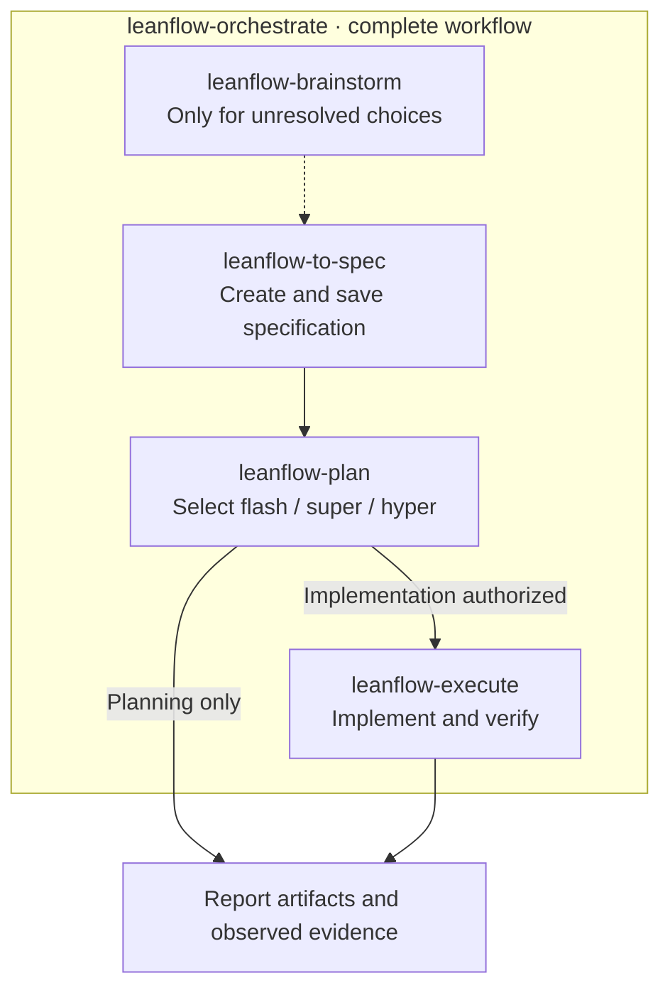

# LeanFlow

**Plan deliberately. Execute simply. Orchestrate end to end.**

Five portable, instruction-based skills for coding assistants. Read the canonical files directly or install them through a small host adapter—without adopting a full personal configuration kit.

Adapters package skills for Oh My Pi (`omp`), Antigravity CLI (`agy`), Claude Code, and Codex; a generic adapter targets another host's documented skill root. Your host supplies models, tools, discovery, delegation, and approval enforcement. LeanFlow is not an agent runtime, model gateway, sandbox, or permission system.

## In this guide

- [Capabilities](#capabilities)
- [Quick start](#quick-start)
  - [Use without installing](#use-without-installing)
  - [Install a host adapter](#install-a-host-adapter)
- [How it works](#how-it-works)
  - [Agent collaboration](#agent-collaboration)
- [Skills and workflows](#skills-and-workflows)
- [Safety and privacy](#safety-and-privacy)
- [Updates and troubleshooting](#updates-and-troubleshooting)
- [Verification and known limits](#verification-and-known-limits)
- [Help and maintenance](#help-and-maintenance)
- [Documentation, sources, and licenses](#documentation-sources-and-licenses)

## Capabilities

- **Five reusable procedures:** use individual skills for brainstorming, specifications, planning, or execution—or use `leanflow-orchestrate` to run the complete workflow.
- **Selectable planning depth:** flash, super, or hyper according to scope, uncertainty, and risk—not model selection.
- **Direct or delegated work:** orchestration runs the workflow directly or uses available native delegation; standalone execution implements an explicitly supplied plan.
- **Portable skill packages:** complete skill directories with on-demand references and license notices; the same canonical skill bytes across adapters.
- **Optional native bindings:** planner, executor, and reviewer bindings for omp, agy, Claude Code, and Codex. Generic mode has no native agents.
- **Explicit installation:** preview changes before writing; managed updates reject local edits and conflicting unmanaged content.

Skills are instructions for the assistant, not guarantees of compliance or isolation. Planning does not authorize implementation, and installing an adapter does not change your host's approval policies.

## Quick start

### Use without installing

For the complete workflow, send this to a file-capable coding assistant from a local checkout:

```text
Read skills/leanflow-orchestrate/SKILL.md, resolve relative references from
skills/leanflow-orchestrate/, and use it to add CSV export to the report
screen: create the specification, plan the change, then implement and verify it.
```

Invoke `leanflow-orchestrate` once; it uses the other skills for the applicable stages. You do not need to invoke each one separately. If material choices remain unresolved, it uses `leanflow-brainstorm` to resolve them before proceeding.

For planning only, use the individual skill:

```text
Read skills/leanflow-plan/SKILL.md, resolve relative references from
skills/leanflow-plan/, and use it to plan adding CSV export to the report
screen. Do not implement it yet.
```

Keep all five complete skill directories accessible as siblings. After reviewing the plan, explicitly authorize execution:

```text
Read skills/leanflow-execute/SKILL.md, resolve relative references from
skills/leanflow-execute/, and implement the plan at .workflow/plans/<plan-file>.md.
```

Replace the example task and plan filename with your own. Plain-file loading does not register commands or prove native compatibility; the assistant must actually read the files, not just recognize their names.

### Install a host adapter

Use Node.js to run the installer and Git to clone the repository. Plain-file skill use needs no installer runtime. No minimum Node.js version is declared; Node.js 24.20.0 is an observed environment, not a requirement.

```bash
git clone https://github.com/rizariaputrawira/leanflow.git
cd leanflow
```

Choose your host and preview before installing:

| Host | Preview | Default destination |
| --- | --- | --- |
| Oh My Pi (`omp`) | `node scripts/install.mjs omp --dry-run` | `~/.omp/agent` |
| Antigravity CLI (`agy`) | `node scripts/install.mjs agy --dry-run` | `~/.gemini/config/plugins/leanflow` |
| Claude Code | `node scripts/install.mjs claude --dry-run` | `~/.claude` |
| Codex | `node scripts/install.mjs codex --target /path/to/project --dry-run` | Explicit project root required |
| Generic | `node scripts/install.mjs generic --target /path/to/host/skills --dry-run` | Explicit host skill root required |

Rerun the selected command **without `--dry-run`** to install. Every default install copies **exactly the five packaged skills** using the same canonical bytes. Codex uses `.agents/skills/` plus opt-in `.codex/agents/` beneath its explicit project target.

Add `--with-agents` to a native adapter to opt into its three `leanflow-planner`, `leanflow-executor`, and `leanflow-reviewer` bindings. Generic installation rejects that option. Use `--target DIR` for a custom destination; consult the relevant setup guide before installing or updating:

[omp](harnesses/omp/README.md) · [agy](harnesses/agy/README.md) · [Claude Code](harnesses/claude/README.md) · [Codex](harnesses/codex/README.md) · [generic](harnesses/generic/README.md)

`install.sh` and `install.ps1` forward arguments to the Node installer; they are not the old full-configuration installer.

## How it works

Canonical skill files own workflow behavior. Host bindings load those procedures rather than duplicate them. The installer bundles the files, validates destinations and the managed-file manifest, then previews or writes the bundle. agy also receives generated plugin metadata.

| Component | Repository source | Role |
| --- | --- | --- |
| Skills | [skills/](skills/) | Five canonical procedures and their relative references |
| Native bindings | [harnesses/](harnesses/) | Optional host-specific planner, executor, and reviewer definitions |
| Installer | [scripts/install.mjs](scripts/install.mjs) | Bundle, destination validation, preflight, and writes |
| Regression suite | [tests/install.test.mjs](tests/install.test.mjs) | Observable CLI and filesystem contracts |
| Workflow guide | [docs/PLANNING_GUIDE.md](docs/PLANNING_GUIDE.md) | Consent, artifact privacy, resumption, and verification |

The destination's `.leanflow-manifest.json` records managed paths and SHA-256 hashes. Replacement is atomic per file, not across the bundle; a write failure can leave a partial installation. There is no automatic rollback or removal.

The adapters do **not** install MCP servers, hooks, or host-global instructions. They do not change credentials, model routing, approval policies, telemetry, workspace settings, or ignore rules. Codex writes only the requested install files and manifest beneath its explicit project target.

### Agent collaboration

The host supplies native delegation; skills define the procedures and authority boundaries. Optional bindings do not establish that dispatch or role behavior works in every host/version.

During parallel orchestration, the coordinator owns integration and is the sole shared-plan writer. Delegates return scoped results, evidence, and blockers—not nested orchestration. If delegation is unavailable, the assistant must disclose the limitation; a delegation-only request must not silently become direct execution.

## Skills and workflows

Ask for the intended work in ordinary language, or name a skill when you want a specific procedure. These are skill names and ordinary requests, not universal slash commands.

| Skill | Use it for |
| --- | --- |
| [`leanflow-brainstorm`](skills/leanflow-brainstorm/SKILL.md) | Explore unresolved goals and tradeoffs without implementing. |
| [`leanflow-plan`](skills/leanflow-plan/SKILL.md) | Research and write a plan; choose planning depth automatically. |
| [`leanflow-execute`](skills/leanflow-execute/SKILL.md) | Implement and verify an explicitly supplied saved or in-chat plan. |
| [`leanflow-orchestrate`](skills/leanflow-orchestrate/SKILL.md) | Run the complete workflow: specification → plan → implementation and verification. Uses the other skills for each stage, including brainstorming when needed. |
| [`leanflow-to-spec`](skills/leanflow-to-spec/SKILL.md) | Synthesize supplied design material or conversation into a reference specification, either standalone or as the specification stage within orchestration. |

### Choose the workflow

- **Plan only:** “Plan this change; do not implement.” `leanflow-plan` selects **flash** for clear, bounded, low-risk work; **super** for integration or moderate uncertainty; **hyper** for high risk or unresolved load-bearing alternatives. Hyper applies five adversarial lenses and one revision. You can request a method in plain language; methods do not select models or require delegation. Planning alone never authorizes implementation.
- **Execute directly:** “Implement this exact plan.” The current assistant implements the saved or in-chat plan you supplied, checks the result, and records actual evidence. No implicit selection of an unrelated plan.
- **Orchestrate end to end:** “Use leanflow-orchestrate to add CSV export: spec, plan, implement, and verify.” This single skill runs the complete workflow using `leanflow-to-spec`, `leanflow-plan`, and `leanflow-execute`, with `leanflow-brainstorm` when material choices need resolving. You do not need to create a specification yourself or invoke the stages separately. The orchestration request authorizes the workflow within the requested scope and host permissions; an explicit planning-only restriction stops it before implementation. A generic build request does not select orchestration. An exact supplied plan is validated against the specification it creates and current evidence, not silently replaced.
- **Document a specification standalone:** request a reference specification from supplied design material or conversation; the literal `leanflow-to-spec` name is optional. It returns a source-grounded reference specification in chat or, when saving is authorized and privacy established, `.workflow/specification/<SEQ>-YYYYMMDD-<slug>-spec.md`. This standalone choice is optional and does not automatically invoke planning or authorize implementation.

No automatic commits, branches, pushes, or PRs are part of the core. See the [planning and execution guide](docs/PLANNING_GUIDE.md) for consent, inline plans, resuming, and replanning.

### Workflow at a glance

`leanflow-orchestrate` runs all stages below as one workflow. Each stage advances only when its required decisions, privacy checks, and permissions are satisfied.



Use individual skills when you need only one stage. Standalone planning and execution do not require a specification.

### Skill selection and on-demand guidance

On a host that supports model-selected skills, you do not need to run a router first. Selection loads guidance, not permission: the assistant must read the actual skill body and required references; your request and the host's permissions still control writes, execution, and external effects. Native selection remains host/version-dependent; see [observed evidence](COMPATIBILITY.md).

The five entrypoints keep common steps and authority boundaries visible. Plan/specification templates, worker procedures, and review detail load only for their applicable branches. Preserve the complete sibling directories when copying skills; references and license notices are part of the package.

Planning and execution share [simplicity guidance](skills/leanflow-execute/references/simplicity.md): reuse existing patterns and choose the smallest complete solution without dropping acceptance or safety checks. English and Indonesian documents share [writing guidance](skills/leanflow-to-spec/references/writing.md), with language-specific idiom, register, terminology, and evidence checks—not word bans or a separate writing skill.

## Safety and privacy

- **Keep authority explicit.** An end-to-end orchestration request authorizes specification, planning, and implementation within its stated scope and host permissions. A planning-only or specification-only request stops at that stage; creating an artifact alone does not authorize more work. Your host enforces approvals; instructions are not a sandbox.
- **Keep artifacts local.** Canonical saved plans live in `.workflow/plans/`; specifications live in `.workflow/specification/`. A saved specification is required before planning in selected orchestration, but remains optional for standalone planning or execution.
- **Establish privacy before saving.** Workflows preserve existing ignore rules and establish both `/workflow/` and `/.workflow/` before saving generated artifacts, including before Git initialization. If writes or privacy setup are unavailable, return a permitted in-chat draft and blocker rather than silently saving elsewhere. Orchestration must then stop before dependent planning or implementation; an inline draft does not replace its required specification file.
- **Keep privacy claims scoped.** Ignore rules do not untrack existing files, encrypt records, hide them from local tools or assistant context, or remove secrets from history. Removing already-tracked artifacts from the index requires authorization and must preserve working files.
- **Distinguish installation from workflow execution.** Installing an adapter does not edit workspace ignore rules; artifact privacy is part of the workflow when it runs. Existing global installs remain user-owned and are not automatically removed.

## Updates and troubleshooting

Update your checkout, then preview a managed update for the host and destination you installed. For example, for omp's default destination:

```bash
git pull --ff-only
node scripts/install.mjs omp --update --dry-run
```

Remove `--dry-run` to apply. For another adapter, use its host name and retain the intended `--target` and `--with-agents` selection. Codex and generic still require explicit targets.

Keep `.leanflow-manifest.json` in the destination. `--update` permits upstream managed-content changes, not overwriting local edits. Omitted managed files remain tracked and are not removed; an update is not an exact mirror or uninstaller.

| Symptom | What to check |
| --- | --- |
| A destination conflicts with existing content | Compare the named files and preserve local work. `--update` does not override conflicting unmanaged content or local edits to managed files. |
| A managed file is missing or the manifest is rejected | Inspect the reported path and manifest; preflight refuses missing managed files and unsafe paths. Consult the host setup guide before changing installation state. |
| A destination is a symlink | Choose a real directory path; preflight refuses symlinks. |
| Codex or generic reports a missing target | Supply `--target DIR`: a project root for Codex, a documented skill root for generic. |
| Generic rejects `--with-agents` | Omit the option; generic mode has no native agent bindings. |
| A skill or agent is not discovered | Check the selected host's setup guide and installed version. Packaging support does not prove native discovery or dispatch. |

Of the former 25 optional packages in `config/skills/`, only `leanflow-to-spec` is retained and promoted to canonical `skills/`; the other 24 and the exclusive migration/health helpers have been removed. Legacy configuration examples are not current adapter inputs. See [historical configuration and telemetry warnings](docs/LEGACY_CONFIGURATION.md) before migrating an older setup.

## Verification and known limits

Run the installer regression suite and preview checks from the repository root:

```bash
node --test tests/install.test.mjs
node scripts/install.mjs omp --dry-run
node scripts/install.mjs generic --target /tmp/leanflow-skills --dry-run
```

The suite checks observable CLI and filesystem behavior, including dry-run nonmutation, host layouts, opt-in agents, update consent, retained files, manifest validation, conflicts, and symlink refusal. Platform-dependent symlink cases skip on Windows.

Package/source checks and installer tests do not prove native dispatch, instruction-following, or containment. Other runtimes may use plain files or their own documented skill discovery; this is not a blanket native-support claim. Consult [compatibility and observed evidence](COMPATIBILITY.md) for exercised hosts, versions, and known limits; historical results retain their original scope.

## Help and maintenance

Open a [GitHub issue](https://github.com/rizariaputrawira/leanflow/issues) for questions or reproducible problems; include the host/version, installation mode, and redacted error output. Maintained by [rizariaputrawira](https://github.com/rizariaputrawira). Do not include credentials or private plan contents.

## Documentation, sources, and licenses

- [Planning and execution guide](docs/PLANNING_GUIDE.md): workflow consent, artifact privacy, resumption, and verification.
- [Host setup guides](harnesses/): destination semantics, optional bindings, and migration details.
- [Compatibility record](COMPATIBILITY.md): package/source checks, observed host behavior, and evidence limits.
- [Sources and notices](skills/SOURCES.md): source pins, modifications, provenance, and license notices.
- [Legacy configuration](docs/LEGACY_CONFIGURATION.md): historical setup and telemetry warnings, not current defaults.

LeanFlow selectively adapts [KitShift](https://github.com/rizariaputrawira/kitshift)'s shared-workflow/native-binding separation, on-demand guidance, writing discipline, and Ponytail-derived simplicity principles—not its full configuration bundle.
